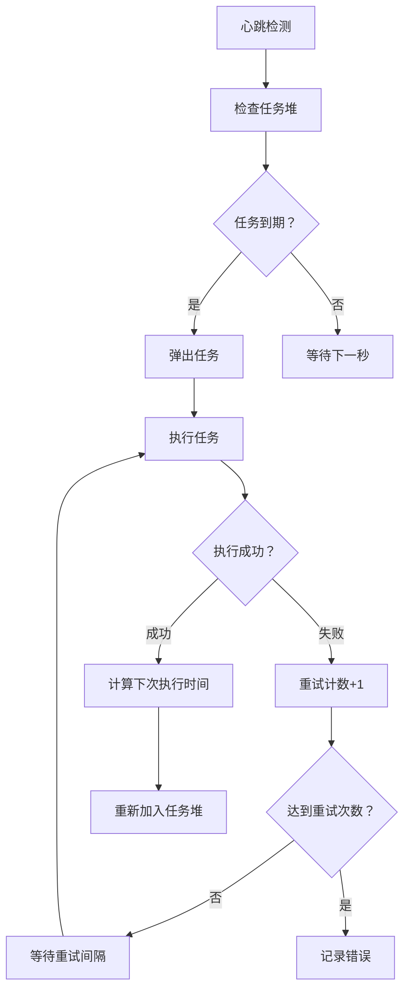

# Cron 定时任务服务

> 为 https://github.com/zly-app/zapp 框架提供的高性能定时任务服务，支持 Cron 表达式和一次性任务，具备任务调度、执行控制、重试机制等丰富功能。

## 项目概述

这是一个为 zapp 框架设计的定时任务服务，基于最小堆算法实现高效的任务调度。该服务支持：
- **Cron 表达式调度**：支持标准 Cron 表达式定义任务执行时间
- **一次性任务**：支持指定时间执行的一次性任务
- **并发控制**：支持任务并发执行数量限制
- **重试机制**：支持任务失败后的自动重试
- **超时控制**：支持任务执行超时设置
- **动态管理**：支持运行时添加、删除、启用/禁用任务
- **优雅启动/停止**：支持服务的启动、暂停、恢复和停止

## 快速开始

### 基本使用

```go
package main

import (
    "github.com/zly-app/service/cron"
    "github.com/zly-app/zapp"
)

func main() {
    // 启用 cron 服务
    app := zapp.NewApp("test", cron.WithService())
    
    // 注册定时任务（每秒执行）
    cron.RegistryHandler("task1", "@every 1s", true, func(ctx cron.IContext) error {
        ctx.Info("定时任务执行", ctx.Task().Name())
        return nil
    })
    
    // 注册一次性任务
    cron.RegistryOnceHandler("once-task", time.Now().Add(time.Minute), true, func(ctx cron.IContext) error {
        ctx.Info("一次性任务执行")
        return nil
    })
    
    // 运行应用
    app.Run()
}
```

### 注册任务方式

#### 1. RegistryHandler - 注册 Cron 任务
```go
// 注册一个每 5 分钟执行一次的任务
cron.RegistryHandler("minute-task", "*/5 * * * *", true, func(ctx cron.IContext) error {
    ctx.Info("每5分钟执行的任务")
    return nil
})
```

#### 2. RegistryOnceHandler - 注册一次性任务
```go
// 注册一个指定时间执行的一次性任务
executeTime := time.Date(2024, 12, 31, 23, 59, 0, 0, time.Local)
cron.RegistryOnceHandler("new-year-task", executeTime, true, func(ctx cron.IContext) error {
    ctx.Info("新年快乐！")
    return nil
})
```

#### 3. RegistryTask - 注册自定义任务
```go
// 创建完全自定义的任务配置
task := cron.NewTaskOfConfig("custom-task", cron.TaskConfig{
    Trigger:  cron.NewCronTrigger("0 0 * * *"), // 每天午夜执行
    Executor: cron.NewExecutor(3, 2*time.Second, 2), // 重试3次，间隔2秒，最大并发2
    Handler: func(ctx cron.IContext) error {
        ctx.Info("自定义任务执行")
        return nil
    },
    Timeout:  30 * time.Second, // 超时时间
    Enable:   true,
})
cron.RegistryTask(task)
```

## 配置说明

### 基础配置

```yaml
services:
  cron:
    ThreadCount: -1        # 线程数，默认为-1（使用逻辑CPU数量的4倍）
    MaxTaskQueueSize: 10000 # 最大任务队列大小，默认为10000，队列已满时新触发的任务会被抛弃
```

### 任务配置

```yaml
services:
  cron:
    ThreadCount: -1
    MaxTaskQueueSize: 10000
    # 任务列表
    tasks:
      - Name: 'daily-report'       # 任务名称
        Expression: '0 0 * * *'   # Cron表达式
        IsOnceTrigger: false      # 是否为一次性任务，如果设为true，则 Expression 的格式为 YYYY-MM-dd hh:mm:ss
        Disable: false            # 是否禁用
        RetryCount: 3            # 重试次数
        RetrySleepMs: 2000      # 重试间隔（毫秒）
        MaxConcurrentExecuteCount: 1 # 最大并发数
        TimeoutMs: 30000         # 超时时间（毫秒）
```

### 配置项说明

| 配置项 | 类型 | 默认值 | 说明 |
|--------|------|--------|------|
| ThreadCount | int | -1 | 线程数，-1表示使用逻辑CPU数量的4倍 |
| MaxTaskQueueSize | int | 10000 | 任务队列大小 |
| Name | string | - | 任务名称 |
| Expression | string | - | Cron表达式或时间格式 |
| IsOnceTrigger | bool | false | 是否为一次性任务 |
| Disable | bool | false | 是否禁用任务 |
| RetryCount | int64 | 0 | 重试次数，0表示不重试 |
| RetrySleepMs | int64 | 0 | 重试间隔（毫秒） |
| MaxConcurrentExecuteCount | int64 | 1 | 最大并发执行数 |
| TimeoutMs | int64 | 0 | 超时时间（毫秒），0表示永不超时 |

## 实现原理

### 架构设计

```
┌─────────────────────────────────────────────────────┐
│                    CronService                      │
│  ┌─────────────────┐    ┌─────────────────────┐     │
│  │   Task Heap     │    │    Task Heap        │     │
│  └─────────────────┘    └─────────────────────┘     │
│  ┌─────────────────┐    ┌─────────────────────┐     │
│  │   Task Heap     │    │    ... 64个         │     │
│  └─────────────────┘    └─────────────────────┘     │
│                ↓                                    │
│      ┌──────────────────────────────────────┐       │
│      │ ┌─────────────────────────────────────┐      │
│      │ │ ┌──────────────────────────────────────┐   │
│      │ │ │            Task (实例)               │   │
│      │ │ │  ┌─────────────┐ ┌─────────────────┐ │   │
│      │ │ │  │ Trigger     │ │  Executor       │ │   │
│      │ │ │  │ (触发器)     │ │ (执行器)        │ │   │
│      └───│  └─────────────┘ └─────────────────┘ │   │
│          └──────────────────────────────────────┘   │
└─────────────────────────────────────────────────────┘
```

### 核心组件

#### 1. 任务调度器（CronService）

- **心跳调度**：每秒执行一次心跳，检查并触发到期任务
- **任务堆管理**：维护64个任务堆，根据触发时间将任务分配到不同堆中
- **并发控制**：使用协程池管理任务执行
- **状态管理**：维护服务的启动、停止、暂停、恢复等状态

#### 2. 任务堆（TaskHeap）

基于最小堆算法实现，用于高效管理任务执行时间：

```go
// 堆结构
type taskHeap struct {
    tasks []*heapTask  // 完全二叉数组存储
}

// 时间复杂度
// Push: O(log n)
// Pop: O(log n) 
// Remove: O(n)
```

#### 3. 任务模型（Task）

每个任务包含：

- **触发器（Trigger）**：确定下一次执行时间
  - CronTrigger：基于 Cron 表达式
  - OnceTrigger：一次性任务
- **执行器（Executor）**：控制任务执行
  - 重试机制
  - 并发控制
  - 超时管理
- **处理器（Handler）**：实际业务逻辑

#### 4. 触发器机制

```go
// CronTrigger 使用 robfig/cron 解析表达式
func (c *CronTrigger) MakeNextTriggerTime(t time.Time) (time.Time, bool) {
    c.mx.Lock()
    // 快速跳过已过期的执行时间
    for t.Unix() >= c.nextExecuteTime.Unix() {
        c.nextExecuteTime = c.schedule.Next(c.nextExecuteTime)
    }
    t = c.nextExecuteTime
    c.mx.Unlock()
    return t, true
}
```

### 执行流程



### 性能优化

1. **多堆分片**：64个任务堆减少堆操作冲突
2. **快速跳过**：触发器快速跳过已过期时间点
3. **协程池**：避免频繁创建销毁 goroutine
4. **最小堆**：确保最快获取最近要执行的任务

### 关键算法

#### 时间分片

```go
// 根据时间戳选择任务堆
func (c *CronService) getHeapOfTime(sec int64) ITaskHeap {
    bucket := sec & (heapsCount - 1)  // 取模分片
    return c.heaps[bucket]
}
```

#### 堆操作

```go
// 上浮操作（插入时）
func (h *taskHeap) up(j int) {
    for {
        i := (j - 1) / 2  // 父节点
        if i == j || !h.less(j, i) {
            break
        }
        h.swap(i, j)
        j = i
    }
}

// 下沉操作（弹出时）
func (h *taskHeap) down(i0 int) {
    i := i0
    for {
        j1 := 2*i + 1  // 左子节点
        if j1 >= len(h.tasks) {
            break
        }
        j := j1
        if j2 := j1 + 1; j2 < len(h.tasks) && h.less(j2, j1) {
            j = j2  // 选择较小的子节点
        }
        if !h.less(j, i) {
            break
        }
        h.swap(i, j)
        i = j
    }
}
```

## 最佳实践

1. **任务设计**：避免长时间运行的任务，拆分为小任务
2. **错误处理**：合理设置重试次数和间隔
3. **并发控制**：根据业务特性设置最大并发数
4. **资源监控**：关注队列积压和任务执行时间
5. **优雅停止**：在服务关闭时确保正在执行的任务完成

## 注意事项

1. 任务名称必须唯一，重复注册会被忽略
2. 超时时间设置为0表示永不超时，可能导致 goroutine 泄漏
3. 队列满时新触发的任务会被丢弃，需要合理设置队列大小
4. 暂停状态下不会执行新任务，但正在执行的任务会继续
5. 服务停止后会等待所有任务执行完毕
